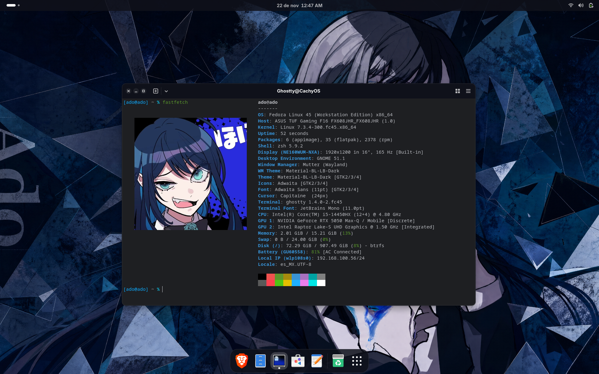

# linux-config



Mis configuraciones opinadas personales de Linux, elegidas para desarrolladores como yo. Todo lo que se instala y configura aquí tiene opinión propia y personalidad, conforme a mis gustos personales y mi stack de desarrollo de software.

## Preferencias personales

**Temáticas:** Anime (Ado, temas de anime)

**Stack de desarrollo:** Java, .NET C#, C/C++, Rust

**IDEs y editores de código:** VSCode, Apache NetBeans, Neovim (Lazyvim)

**Gustos de colores**: Tonos azules, grises y negros.

**Terminal y shell:** Ghostty con Zsh

## Especificaciones

**Distro recomendada:** Fedora Workstation 45

**Shell:** GNOME 51.1

**Versión de GTK:** GTK 4

**Shell de preferencia:** Zsh


## Uso rápido

### Instalación en un sistema limpio
```bash
git clone https://github.com/hazelcode/linux-config
cd linux-config
./install.sh
```

### Consulta para más opciones (Instala partes específicas)
```
./install.sh --help
```

## Programas o componentes a instalar

**Advertencia: Por preferencias personales se instalarán herramientas de desarrollo como .NET, Rust y C/C++, así como editores de código e IDEs como Apache NetBeans y VSCode**

*El repositorio instala los siguientes programas o componentes:*

### Instalaciones manuales (automatizadas)

- Una instalación manual de .NET 10.0 (Via script)
- Una instalación manual de Rust (Via script)

### Flatpak
- Gear lever
- Flatseal
- GNOME Extensions
- GNOME Extension Manager (por Matthew Jakeman)
- GDM Settings
- Apache NetBeans

### DNF
- *Habilita repositorio de software privativo*
- Ghostty
- Neovim
- Fastfetch
- Zsh
- `zsh-autosuggestions`
- `zsh-syntax-highlighting`
- `util-linux-user` *(Asegura la disponibilidad del comando chsh)*
- `glib2-devel` *(Indispensable para compilar la personalización del GDM)*
- Git
- Ninja
- CMake
- Make
- GCC
- Clang
- GDB
- OpenJDK 25 LTS
- Vscode *(Intencionalmente como paquete de sistema, no como Flatpak debido al sandbox)*
- GNOME Tweaks
- Extensión de GNOME: Dash To Dock
- Extensión de GNOME: User Themes
- Extensión de GNOME: AppIndicator and KStatusNotifierItem Support
- `libappindicator-gtk3` *(Para el soporte de iconos en bandeja)*

### Configuraciones
*Este repositorio provee configuraciones para los siguientes programas o paquetes, pero no se limita a:*

- zsh
- ghostty
- neovim
- fastfetch
- grub2
- gtk3
- gtk4

El repositorio configura una instalación manual de **Dotnet** y el servidor LSP de **Roslyn** listos para Lazyvim, así como la **variable de entorno $PATH**
